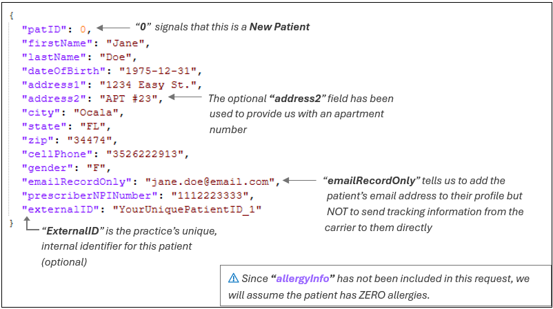
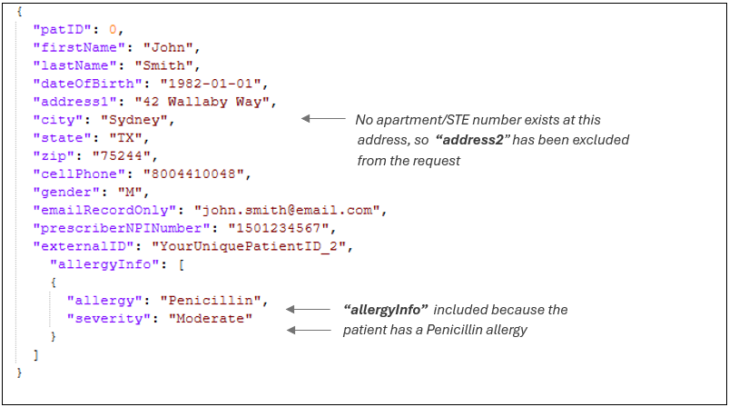
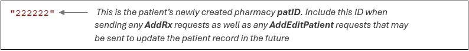
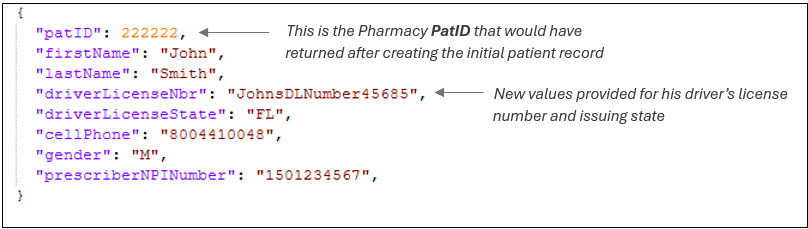
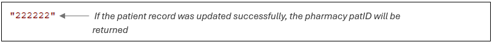

The <Badge color="yellow">AddEditPatient</Badge> endpoint is intended for adding new patient information or updating existing patient records. In this section, we will look at examples of both.

## ADDING a New Patient

### Jane Doe

Request:

Response:

---

### John Smith

Request:

Response:

---

## UPDATING a Patient Record

### John Smith

In this example, the <Badge color="yellow">AddEditPatient</Badge> endpoint is being used to add driver’s license information to John Smith’s existing patient record.

Request:

Response:

