The <Badge color="yellow">Add Rx</Badge> endpoint is intended for adding new prescriptions.

Request payload requirements are context-dependent. Depending on the prescribing scenario, certain fields may be required, optional, or prohibited, and formatting requirements may differ based on:

• Medication type & DEA classification\
• Patient history with the pharmacy\
• Prescriber credentials and license type\
• State-specific prescribing requirements\\

The examples below demonstrate some of the most common prescribing scenarios and highlight how request payloads can vary between them.

---

## New Order: Jane Doe

### Capsules

Request:

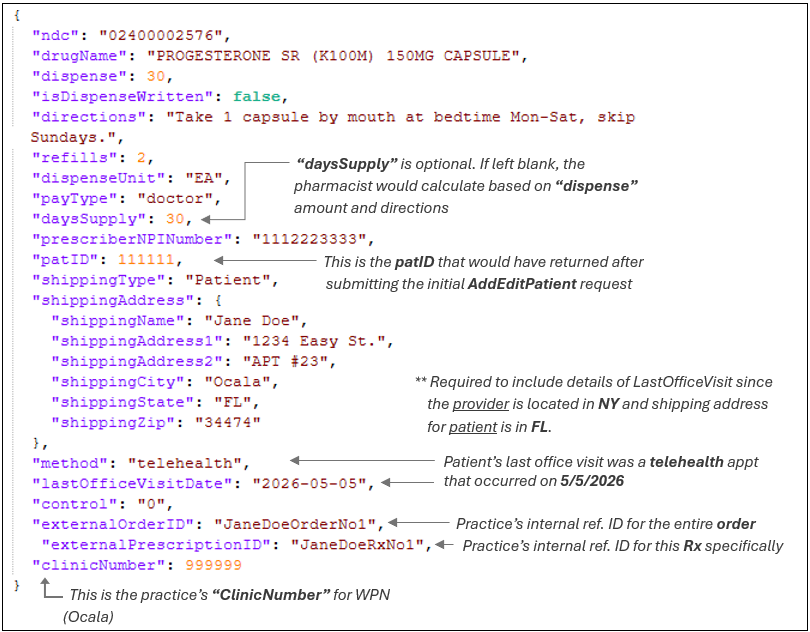

Response:

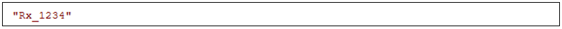

---

### Cream

Request:

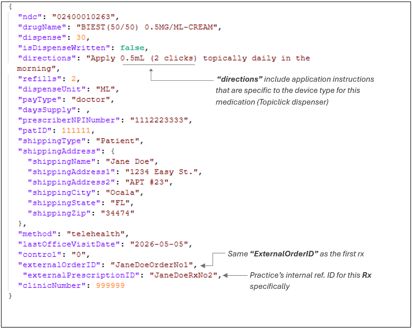

Response:

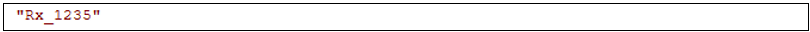

---

### Foam

Request:

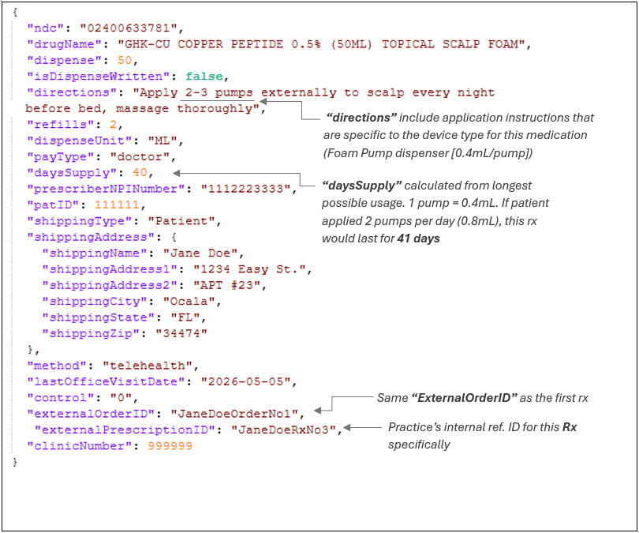

Response:

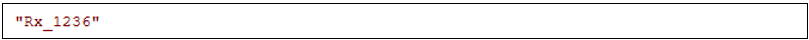

---

## New Order: John Smith

### Injectable (Multi-Dose Vial)

Request:

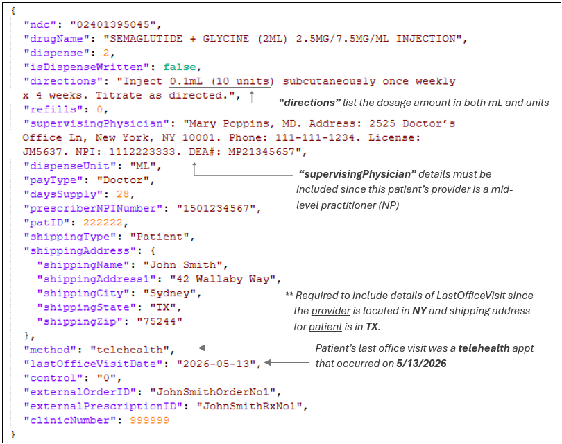

Response:

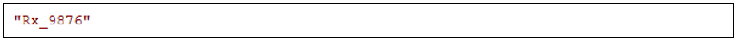

---

### Lyophilized Injectable

Request:

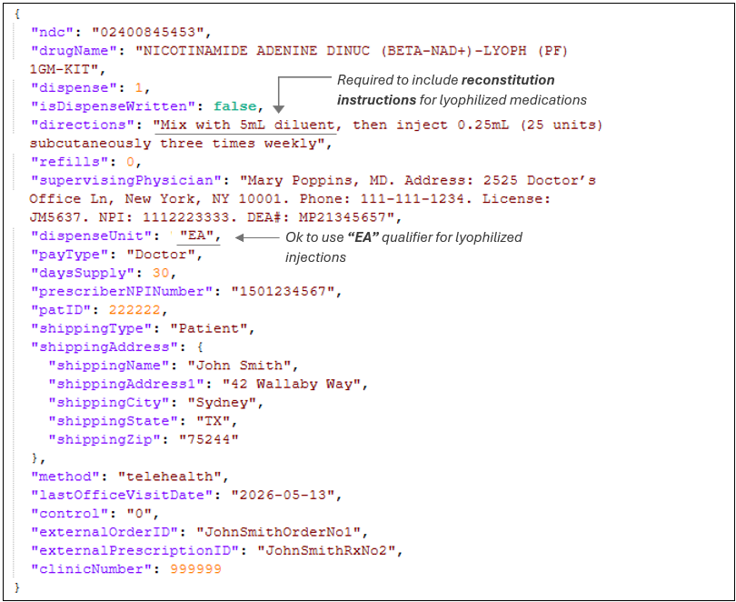

Response:

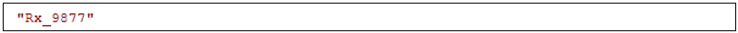

---

### Injection Supplies (Syringes)

<Note>
  Sure Comfort Syringes are pre-packaged by the manufacturer in 10-count bags and must therefore be ordered in quantities of 10. All other syringes, needles, and injection kits may be ordered individually.
</Note>

Request:

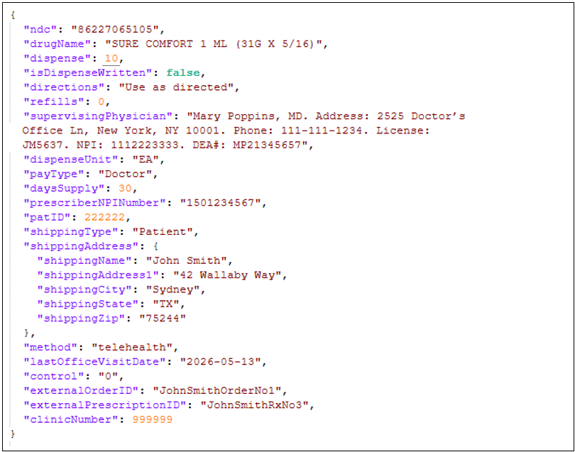

Response:

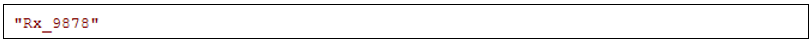

---

### Nasal Spray

Request:

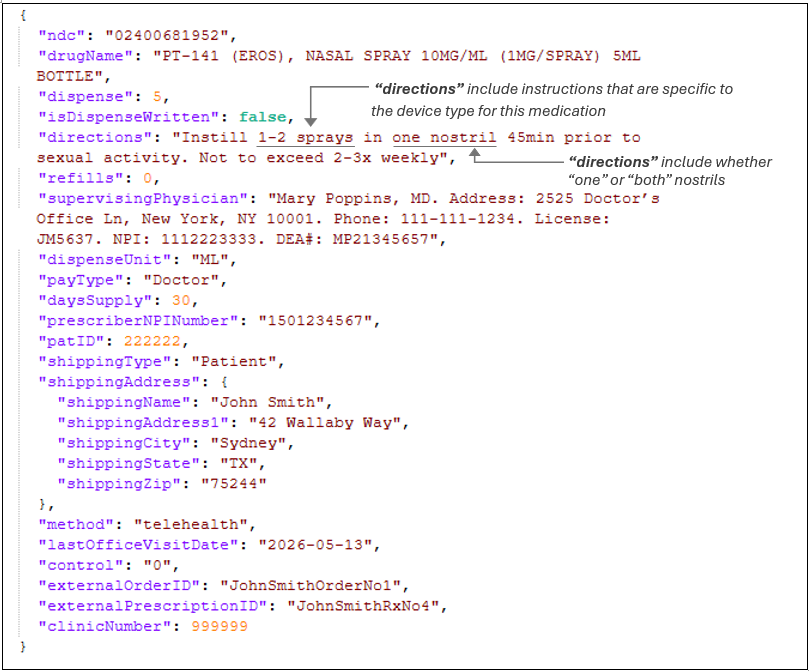

Response:

---

### Controlled Substance Injectable

<Note>
  A DEA number must be on file for any prescriber submitting controlled substance prescriptions. If needed, provide this information directly to the pharmacy; it does not need to be included in API requests. In the example below, assume the prescriber’s DEA number is already on file.
</Note>

Request:

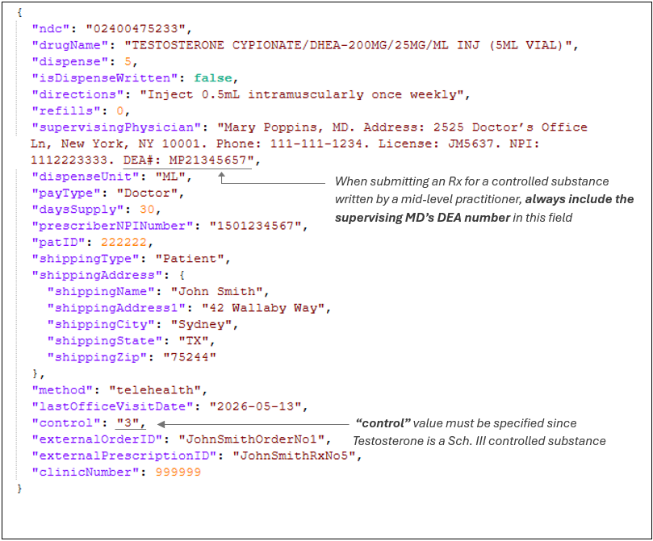

Response:

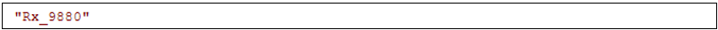

---